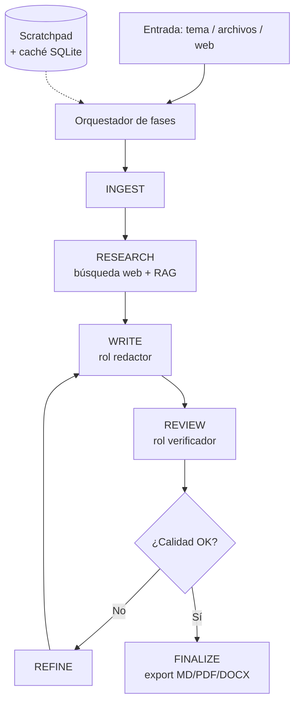

# 🧠 Agente Escritor

> **Pipeline multi-agente en Python** que investiga, redacta, revisa y refina
> documentos técnicos de forma autónoma, orquestando un LLM (DeepSeek) a través
> de fases especializadas, con RAG y evaluación de calidad automática.

---

## ¿Qué hace?

Le das un tema (y opcionalmente documentación de contexto) y el agente produce un
documento técnico completo pasando por un **pipeline de fases**, donde cada fase
actúa como un "rol" especializado dentro de un equipo de redacción:

```
INGEST → RESEARCH → WRITE → REVIEW → REFINE → FINALIZE
```

- **INGEST** — ingiere y normaliza el material de entrada (ficheros, texto, web).
- **RESEARCH** — investigación web profunda (multi-query + extracción de URLs).
- **WRITE** — redacción del documento por un rol "redactor".
- **REVIEW** — revisión crítica por un rol "verificador".
- **REFINE** — refinamiento iterativo (hasta N pasadas).
- **FINALIZE** — cierre, formateo y exportación.

Además incluye una **interfaz web (Streamlit)** con progreso en tiempo real y
subida de archivos.

---

## ✨ Características

- 🔁 **Pipeline multi-agente por fases** con prompts dinámicos por rol y tipo de documento.
- 📚 **RAG** con similitud semántica (`sentence-transformers`) y *fallback* a TF-IDF.
- 🌐 **Investigación web profunda**: multi-query y extracción del contenido de las URLs.
- ✅ **Evaluación de calidad** combinando el LLM con heurísticas.
- 🧠 **Scratchpad persistente** que preserva el contexto entre iteraciones.
- 🌍 **Detección de idioma** y salida configurable.
- 📄 **Exportación** a Markdown, PDF (`fpdf2`), DOCX y diagramas Mermaid.
- 🖥️ **Interfaz web** con Streamlit: progreso en vivo y subida de archivos.
- 💾 **Memoria/caché** en SQLite para evitar reprocesar trabajo.
- 🧯 **Degradación elegante**: los imports opcionales (PDF, embeddings) fallan sin romper el flujo.

---

## 🏗️ Arquitectura



**Separación de responsabilidades:**

| Fichero | Responsabilidad |
|---|---|
| `escritor_autonomo.py` | Motor: pipeline de fases, RAG, evaluación, exportación |
| `app.py` | Interfaz web (Streamlit) con progreso en tiempo real |
| `config.json` | Configuración del pipeline (modelos, RAG, límites) |
| `iniciar.sh` | Lanzador de la interfaz web |

---

## ⚡ Instalación

Requiere **Python 3.10+**.

```bash
# 1. Clonar
git clone https://github.com/arulcancela/agente-escritor.git
cd agente-escritor

# 2. Entorno virtual
python3 -m venv env
source env/bin/activate

# 3. Dependencias
pip install -r requirements.txt

# 4. Configurar la API key
cp .env.example .env
# Edita .env y pon tu DEEPSEEK_API_KEY
```

---

## 🚀 Uso

### CLI

```bash
# Asegura la API key en el entorno
export DEEPSEEK_API_KEY="sk-..."

# Ejecutar el pipeline sobre un tema
python escritor_autonomo.py "Documentación técnica sobre Docker y contenedores"
```

### Interfaz web (Streamlit)

```bash
./iniciar.sh
# o bien:
streamlit run app.py
```

La app permite subir documentos de contexto, lanzar el pipeline por fases y ver
el progreso en tiempo real.

---

## ⚙️ Configuración (`config.json`)

Parámetros principales:

| Clave | Descripción |
|---|---|
| `modelo_agente` / `modelo_redactor` / ... | Modelos por rol. |
| `rag_chunk_size`, `rag_top_k` | Tamaño de fragmento y nº de resultados del RAG. |
| `web_max_results`, `web_deep_search` | Profundidad de la investigación web. |
| `max_iteraciones`, `refinamiento_max` | Límites del bucle de refinamiento. |
| `idioma_principal`, `idiomas_salida` | Idiomas de trabajo y salida. |

> `github_token` y `notion_token` son opcionales; déjalos vacíos si no usas esas
> integraciones.

---

## 🛠️ Stack

Python · OpenAI SDK (API compatible DeepSeek) · scikit-learn (TF-IDF/RAG) ·
`ddgs` (búsqueda web) · BeautifulSoup · Streamlit · fpdf2 · python-docx · SQLite

---

## 📌 Notas de diseño

- **Los imports opcionales degradan con elegancia**: si no hay PyTorch/embeddings,
  el RAG usa TF-IDF; si no hay generador de PDF, se exporta a Markdown.
- **La caché SQLite** evita repetir búsquedas y generaciones costosas (ahorro de
  tokens y tiempo).
- **Scratchpad persistente**: el contexto se mantiene entre iteraciones, lo que
  mejora la coherencia del documento final.

---

## 📄 Licencia

MIT
